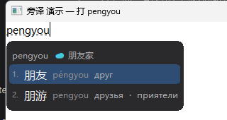

# 旁译 Pangyi · 中文 → 俄语 输入法

敲拼音，候选窗里每个中文候选后面直接跟着俄语释义（带重音）。

> 灵感来自 [青简 Qingjian](https://qingjian.app)（青简做英/日/西，本项目专做**中文 → 俄语**）。
> 全部数据免费、全部在本机运行、无广告、无联网。

## 它是什么

不是外挂悬浮窗，是**真正的 Windows 系统输入法**（TSF TIP —— Text Services Framework Text Input
Processor），和微软拼音同一层级：装一次，在记事本、Word、浏览器、QQ、微信等**任何软件**里按
`Win + 空格` 切过去就能用，不需要先打开任何程序。



## 功能

| 功能 | 说明 |
|---|---|
| 拼音输入 | 全拼；`ü` 用 `v` 代替（`nv`→女、`lvxing`→旅行、`falv`→法律） |
| 中俄对照候选窗 | 候选列表里每个中文词后面直接跟俄语释义（带重音符号） |
| 多音字 | 一个读音一条记录（都 dōu / 都 dū 都能打出来） |
| 首字母缩写 | `gz`→工作、`zhg`→这个、`zyzzj`→中央政治局、`zhrmghg`→中华人民共和国（14.5 万条多音节词自动生成缩写键） |
| 候选翻页看全部 | 整个读音组都在候选池（打 yi 有 530 条 / 59 页），微软同款翻页键 `-`/`=`、PageUp/PageDown；`↑` `↓` 撞到页首页尾自动接上；候选窗右下角显示「▲▼ 第几页/共几页」 |
| 大写英文 | Shift/Caps＋字母直接出大写；拼音中间按 Shift/Caps＋字母＝首选候选上屏＋大写字母直通（微软一致）；拼音中间按标点＝首选上屏＋标点不丢 |
| 中/英模式 | 单独按 Shift 切换（不抢 Ctrl+C/V/A、Alt+F4、Win+D） |
| 自定义短语 | 支持 |
| 设置面板 | 候选个数 / 字号 / 排版 / 主题，都在同一个 exe 里，**没有悬浮面板** |

## 下载与安装

从 [Releases](../../releases) 下载最新的 `旁译-vX.Y.Z.exe`：

1. 双击运行。SmartScreen 提示时点「更多信息」→「仍要运行」
   （个人开发者，未购买代码签名证书）。
2. **重启已经打开着的软件** —— TSF 只在程序启动时加载输入法 DLL，
   早开着的窗口用的还是旧词库。
3. 按 `Win + 空格` 切到「旁译」，直接敲拼音（`kaifa` → 候选窗出现「开发」+ 俄语释义）。

卸载：双击桌面「旁译.exe」→ 卸载；或 `"C:\Program Files\Pangyi\pangyi.exe" --uninstall`。

安装包 sha256 见 Release 说明。

> 升级后个别老程序里打不出新词：重启那个程序即可。
> 切到旁译打不出字：注销一次再登录（TSF 会重新加载 DLL）。

## 数据

- 词条 **294,797 条**：所有中文词都能打，其中带俄语译文的在候选窗里显示释义
- 全部来自免费数据：CC-CEDICT、俄语维基词典（含 kaikki 英文维基枢轴）、Wikdict、
  FreeDict、Unihan、jieba 词频 —— 未使用任何付费翻译 API
- 署名与分发型许可见 [NOTICE.md](NOTICE.md)（CC BY-SA 系列，分发必须保留）

## 反馈

bug / 建议直接开 [Issue](../../issues)，中文即可。欢迎试用并反馈。

## 从源码构建

Windows + Rust（[rustup](https://rustup.rs)）：

```powershell
cd ime
cargo build --release                    # 64 位 pangyi_ime.dll（cdylib）
# 32 位 DLL：需要 tools/llvm-mingw 工具链 + build/x86-stub.o（见 build.rs）
# 安装包 exe：把两个 DLL 放进 ime/payload/ 后
cargo build --release --bin setup        # 输出 pangyi-setup.exe
```

词库 `ime/src/dict.tsv` 以 `include_str!` 直接编进二进制，没有任何运行时数据文件依赖。

## 许可

- 代码：MIT（见 [LICENSE](LICENSE)）
- 数据：CC BY-SA 系列 —— 分发时必须保留 [NOTICE.md](NOTICE.md) 并以相同方式共享
